# Wheel & Tire Selection — Jato 4SS

> **Running: HSP-style 1/8 buggy wheels (86B-801), bought black and painted chrome, on the stock-mounted tires with blue closed-cell foams.** Replaces the IMEX rim + 26013 tire combo below as the daily set. **Noticeably firmer and less "fuzzy" than the soft race tires**, and handles significantly more RPM/power before ballooning or ripping. The tire's internal rib structure holds the tread flat under load instead of bulging, which is what buys the extra traction. Trade-off is weight: it's heavier than the soft wheels, so glide and initial acceleration are a touch down.
>
> **Chrome is a paint job, not plating.** Bought the cheaper black 86B-801 set and colored the rim faces with a chrome paint marker for the IMEX look at a fraction of the price. Looks right so far; durability of the finish is still unproven.
>
> **Wheel cost: $26.79 actual paid** (list $32.29, Shop1105264859 Store on AliExpress, completed 2026-10-01). Bought as one mounted set (tire + rim), no separate re-tire cost to track. Plus a one-time **$7.99** Harbor Freight leather hole punch, reusable on any rim for drainage holes (see [Notes](#notes)).

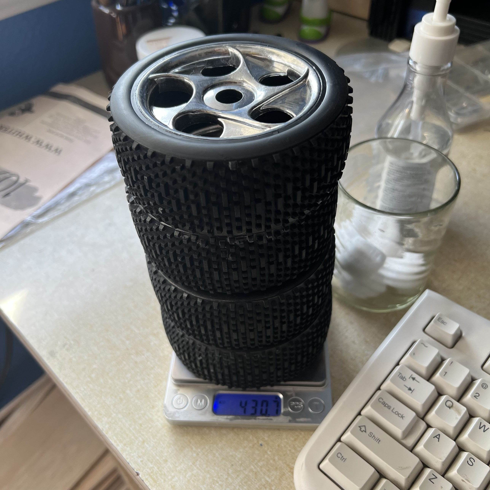 <em>86B-801, painted chrome, mounted + foamed: 🚧 430.7 g / set of 4 as weighed (component breakdown doesn't sum cleanly yet, see <a href="#notes">Notes</a>)</em>

---

## Key Requirements

| Requirement | Type | Why |
|---|---|---|
| **17mm hex, standard (non-star) rim** | May | Standard 17mm mounts easiest, but star-hex rims still work (the rear star hex takes them, or cut the front teeth), so it's a preference not a hard rule. See [wheel hexes](driveshaft_analysis.md#17mm-wheel-hexes) |
| **ROAR-legal track width** | ~~Must~~ **Dropped** | This car runs **mod class, not ROAR**, so there is no width limit to respect. Standard-width rims are still what it runs, but that is now a choice rather than a rule, and the **wide Traxxas rims are back on the table** (see notes) |
| **Grips the blown-out dirt at Meldrum Bar** | Must | The [home track](README.md#track--setup-philosophy) is dry, rutted, loose over hard base |
| **Long wear life** | May | Fewer tire changes. RedSpider wears slowest, and the Mitsubishi-tread 26013 turns very durable once worn in |
| **Cheap / replaceable** | May | Budget AliExpress tire, easy to re-buy |

---

> *Everything below is counted and priced as a **set of 4** (one full car's worth), wheels, tires, and foams alike.*
>
> *Every wheel / tire / rim here I've **personally run and tested**, so the grip, wear, and rip notes are from real track time, not spec sheets.*

## Full Wheels (mounted tire + rim sets)

Complete sets, tire already on the rim. **The 86B-801 below is running now** (painted chrome), replacing the old IMEX rim + 26013 tire + foam combo described in [Rims](#rims-bare-wheels) and [Tires](#tires-tire-only-mount-on-your-own-rims).

> *Spec format: Part · Type · Tread · Compound · Dia · Width · Rim · Hex · Weight · Foam · Pre-glued · Price*

| Wheel set | Spec | Pros / Cons | Photo / Link |
|---|---|---|---|
| ⭐ **HSP-style 1/8 buggy wheels + tires, 112 × 43mm (86B-801)** — *running, painted chrome* | **Part:** 86B-801 (black, painted chrome), AliExpress (Shop1105264859 Store), listed for HSP / HPI / Himoto 1/8 buggy **Type:** 1/8 buggy wheel + tire, mounted **Tread:** dense block, ribbed interior keeps the tread flat under load instead of ballooning **Compound:** firm, noticeably stiffer than the soft race tires above, handles significantly more RPM/power **Dia:** **112mm** **Width:** **43mm** **Rim:** 5-spoke swirl, painted chrome (marker, not plated), same style as the IMEX IMX7893 **Hex:** 17mm **Weight:** 🚧 **430.7 g / set of 4** as weighed (see [Notes](#notes)) **Foam:** blue closed-cell (reused from the old combo; stock foam would likely have done fine too, see [Notes](#notes)) **Pre-glued:** mounted **Price:** **$26.79 / set of 4** (actual paid, 2026-10-01, Shop1105264859 Store, list $32.29) | Pro: **Firmer compound takes significantly more RPM/power before it balloons or rips** than the soft race tires, the rib design holds the tread flat for max traction under load. Same swirl look as the IMEX for a fraction of the price once painted. **Now the daily driver**  Con: **Heavier than the soft wheels**, so glide and initial acceleration are a touch down. Chrome is a paint job, not plating, long-term wear on the finish is unproven. 🚧 Bare-rim / bare-tire / foam weights don't sum cleanly against the set-of-4 total yet, recheck pending | &nbsp;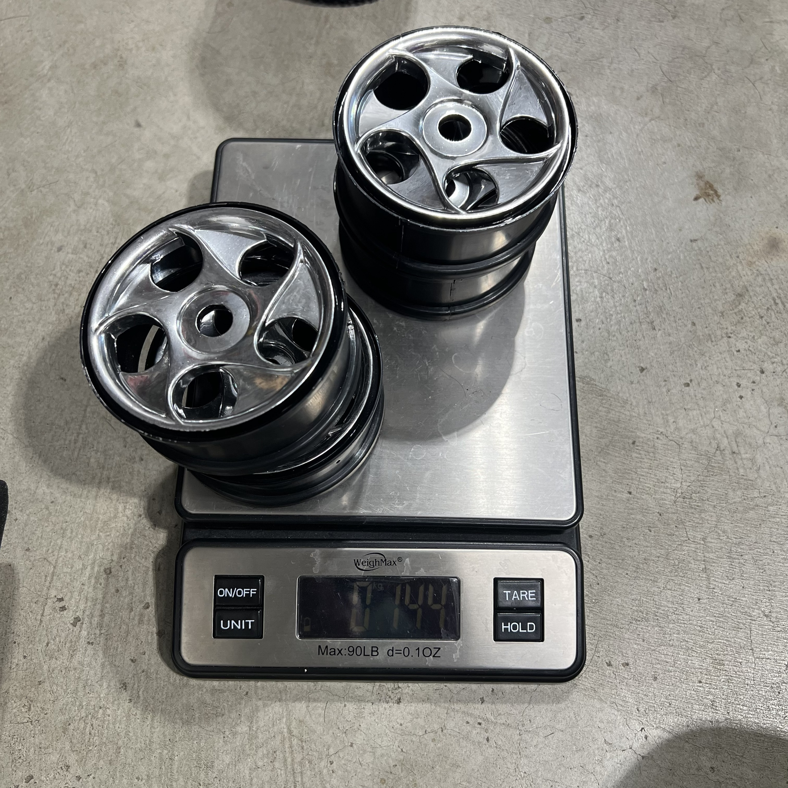 <em>mounted + foamed, 430.7 g / set of 4 · bare rim pair, 🚧 144 g</em> |
| 🟢 **RED SPIDER R235 / R305** — *most durable full set, in hand* | **Part:** **R235 / R305** (R305 = white version) **Type:** 1/8 off-road buggy **Tread:** mini-pin / block **Compound:** soft rubber (unmarked) **Dia:** **118mm** (OD) **Width:** N/A **Rim:** RED SPIDER colored dish rims (17mm hex) **Hex:** 17mm **Weight:** N/A **Foam:** included **Pre-glued:** mounted set **Price:** **$18.61 / set** (RED SPIDER Store) | Pro: **Takes a few laps to wear in, then hooks really well.** **Wears slowly and keeps gripping for a long time**, the standout trait, and the **most durable of the sets I have**. Fits 1/8 buggies (Kyosho MP10 / Traxxas Jato / HSP / VRX). Cheap, colored rims are a free cosmetic pick  Con: **Not at full grip when fresh**, give them a few laps. Weight + paid price still to log | 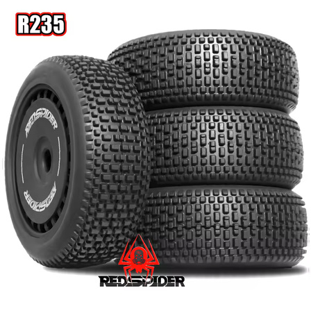&nbsp;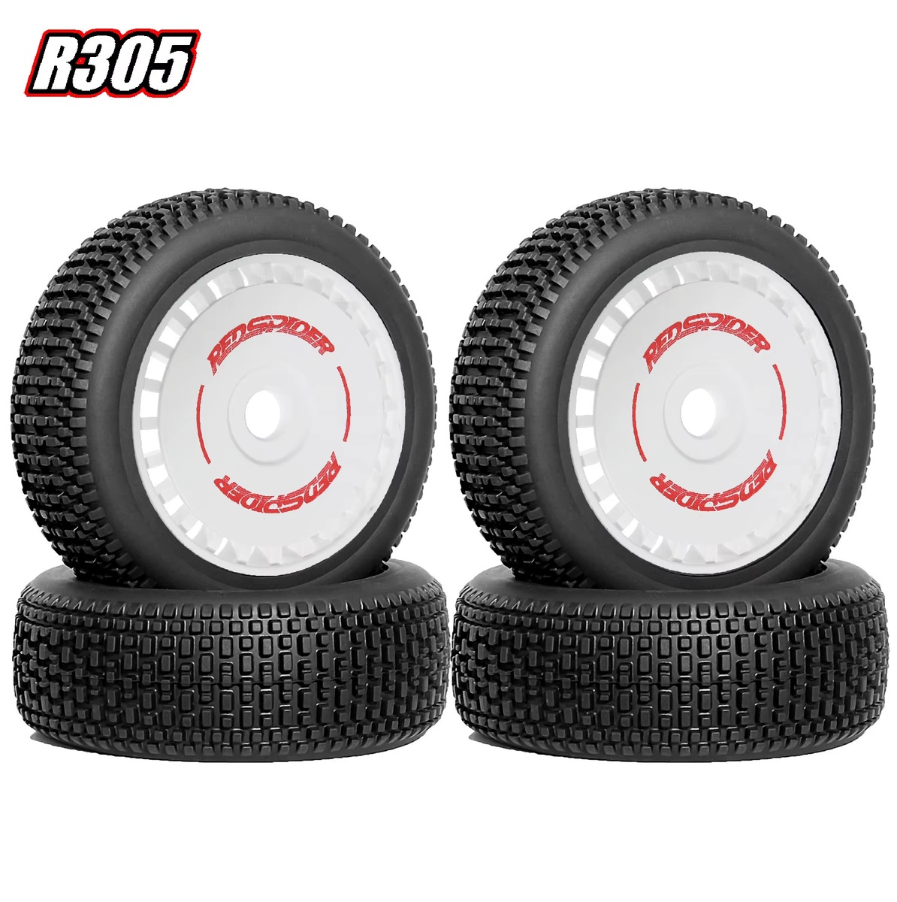 <em>R235 · R305 (white)</em> |
| 🥈 **PowerHobby Armor, belted all-terrain, White Dish (PHT2410DW)** — *best all-rounder, in hand* | **Part:** **PHT2410DW** (PowerHobby) **Type:** 1/8 buggy, **belted all-terrain** **Tread:** ATV-inspired all-terrain **Compound:** soft-ish **Dia:** 4.48" (height) **Width:** 1.74" **Rim:** white dish, 17mm hex **Hex:** 17mm **Weight:** heavier (belted) **Foam:** **closed-cell inserts** **Pre-glued:** mounted / glued **Price:** **$34.95 / pair** (so ~$69.90 / set of 4) | Pro: **Surprisingly grippy and lasts a very long time.** **Belted, so it won't balloon or rip** at high RPM like the non-belted race tires. Good on **grass, dirt, and most tracks**, closed-cell inserts included. **If you want one best all-rounder, this is it**  Con: **A bit heavier** (the belt). **Priced per pair**, so a full set of 4 is ~$70, pricier than the AliExpress sets. **For strict racing on the blown-out dirt I'd still take a race tread** (the 26013 I used to run, the 86B-801 now, or the RedSpider R235/R305), the Armor is the all-rounder for mixed surfaces, not the race-day tire here | 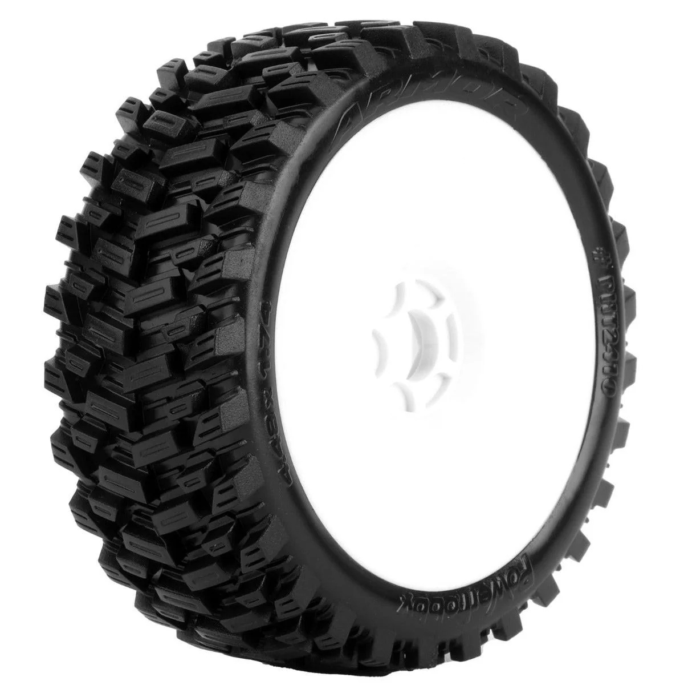 |
| 🔵 **Tokyo Speed T wheels** — *alternate full set of 4, in hand* | **Part:** 🚧 TBD (Tokyo Speed SKU / order ID) **Type:** 1/8-buggy-style off-road race **Tread:** block / mini-pin **Compound:** soft (race) **Dia:** N/A **Width:** N/A **Rim:** dish, 17mm hex (matched set of 4, interchanges with the RedSpider wheels) **Hex:** 17mm **Weight:** N/A **Foam:** included **Pre-glued:** mounted set **Price:** **$20 / set of 4** | Pro: **Complete matched set of 4**, drops onto the same 17mm hexes as the rest; **better than stock**; colors available (white / yellow / green / black); cheap  Con: **Mid all-round**, no standout trait. **Less durable than the RedSpider and can rip sometimes.** Soft race tire, mind the RPM (see notes) | 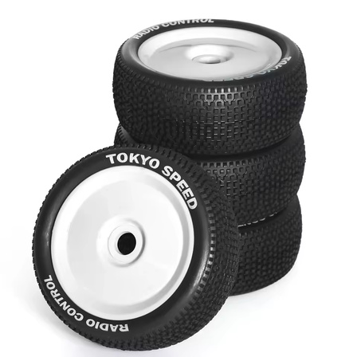 |
| 🔵 **Unbranded budget set** — *my first set, superseded* | **Part:** N/A (unbranded) **Type:** 1/8-buggy-style off-road **Tread:** block **Compound:** soft **Dia:** N/A **Width:** N/A **Rim:** yellow dish, 17mm hex (set of 4) **Hex:** 17mm **Weight:** N/A **Foam:** included **Pre-glued:** mounted set **Price:** **$13.17 / set of 4** (cheapest full set) | Pro: **Good grip for the price**, the first set I ran, cheapest of the full sets  Con: **Weak rims** and the **tire wore down fast**, both the RedSpider and Tokyo Speed outlast it. Fine as an entry set, superseded now | 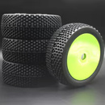 |
| 🔵 **RED SPIDER R306** — *RedSpider variant, wrong surface for this track* | **Part:** **R306** (RED SPIDER) **Type:** 1/8 off-road buggy **Tread:** aggressive knob / lug **Compound:** soft **Dia:** **118mm** (OD) **Width:** N/A **Rim:** dish, 17mm hex (set of 4) **Hex:** 17mm **Weight:** N/A **Foam:** included **Pre-glued:** mounted set **Price:** **$20 / set of 4** | Pro: Same RedSpider brand + size (118mm, 17mm hex); **better on grass and some concrete** with the bigger knobs  Con: **Not ideal for the blown-out dirt at Meldrum Bar**, the aggressive lugs suit grass/concrete more than dry loose dirt. Stick with the **R235 / R305** mini-pin here | 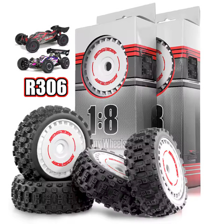 |
| 🔵 **AKA Impact, pre-mounted white EVO wheels (AKA14007XRW)** — *premium non-AliExpress alt* | **Part:** **AKA14007XRW** (AKA) **Type:** 1/8 buggy pre-mount (EVO wheel) **Tread:** dense small square lug, offset center rows **Compound:** Soft, Long Wear **Dia:** N/A **Width:** N/A **Rim:** white AKA EVO dish, 17mm hex **Hex:** 17mm **Weight:** N/A **Foam:** AKA soft red insert **Pre-glued:** pre-mounted, hand-glued **Price:** **$31.99 / pair** (~$63.98 / set of 4) | Pro: **Grip sits between the Tokyo Speed and the RedSpider**, predictable side bite + forward traction, long-wear compound. **Good alternative if you don't want to buy from AliExpress** (US name-brand, AMain). Race-proven AKA  Con: **Non-belted**, so it rips at high RPM like the other race tires. Pricier (per pair) than the AliExpress sets, and still not quite the RedSpider for my track | 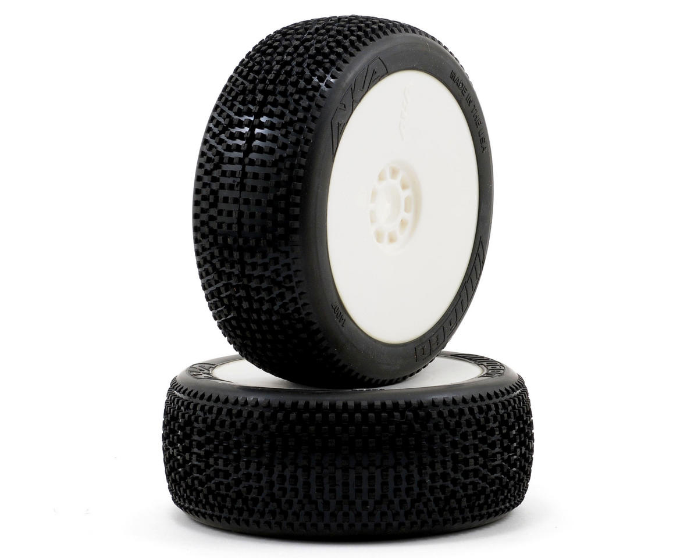 |
| 🔵 **AKA I-Beam, pre-mounted white EVO wheels (AKA14001W-P)** — *used to run, discontinued* | **Part:** **AKA14001W-P** (AKA) **Type:** 1/8 buggy pre-mount (EVO wheel) **Tread:** I-Beam (large center lugs + alternating I-beam outer) **Compound:** soft (AKA) **Dia:** N/A **Width:** N/A **Rim:** white AKA EVO dish, 17mm hex **Hex:** 17mm **Weight:** N/A **Foam:** AKA soft red insert **Pre-glued:** pre-mounted, hand-glued **Price:** **$32.99 / pair** (~$65.98 / set of 4), **discontinued** | Pro: **Grip on par with the RedSpider**, balanced acceleration + cornering tread, quality AKA pre-mount  Con: **More expensive than the RedSpider and wears faster.** **Discontinued** now, and non-belted (rips at high RPM). Used to run these; the RedSpider gives the same grip cheaper and with longer wear | 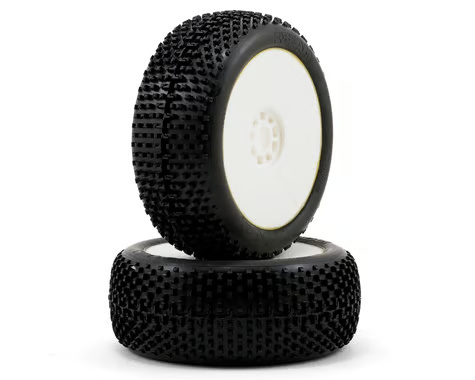 |
| 🔵 **Pro-Line Hole Shot 2.0, 1/8 buggy 17mm (PRO9041-233)** — *used to run, same as RedSpider* | **Part:** **PRO9041-233** (Hole Shot 2.0, 1/8, 17mm, S3, Lightweight Velocity wheel) **Type:** 1/8 buggy pre-mount **Tread:** Hole Shot mini-pin (small square lug) **Compound:** S3 **Dia:** 4.33" / 110mm **Width:** 1.68" / 43mm **Rim:** white Lightweight Velocity dish, 17mm hex **Hex:** 17mm **Weight:** light wheel (~35.6g/set lighter than 2702 V2) **Foam:** reusable closed-cell included **Pre-glued:** pre-mounted **Price:** **$31.99 / pair** (~$63.98 / set of 4) | Pro: **Same performance as the RedSpider** (both are mini-pin race treads, comparable grip). Iconic hard-pack/dusty race tread, lightweight wheel, USA-made, reusable closed-cell foam  Con: Pricier than the RedSpider for the same result. Non-belted (rips at high RPM) | 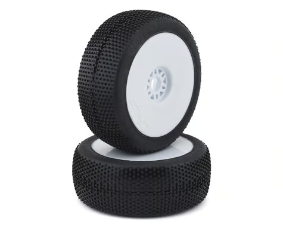 |
| 🔵 **Traxxas Response Pro on white 3.0" wheels (9074_WHT)** — *wide track + star hex* | **Part:** **9074_WHT** (off Jato 4x4 VXL 90386-4) **Type:** 1/10 3.0" buggy **Tread:** Response Pro (spike) **Compound:** ultra-soft **Dia:** ~4.4" OD **Width:** ~1.8" **Rim:** white dished 3.0", **17mm STAR hex** **Hex:** 17mm star **Weight:** N/A **Foam:** included **Pre-glued:** assembled / glued **Price:** **$40.97 / set of 4** (Jenny's RC) | Pro: **Great rims, make the car much wider** (wider track, more stability), **great for mod class** where width is unrestricted. Good grip. OEM assembled with foam  Con: **Star-hex only:** the rear star hex (TKR5570-17) takes them, but the **front non-star (TKR1654-17) won't** unless you cut the little star teeth out (or accept a bit of binding forcing a normal hex on). **Wears fast and rips very easily** | 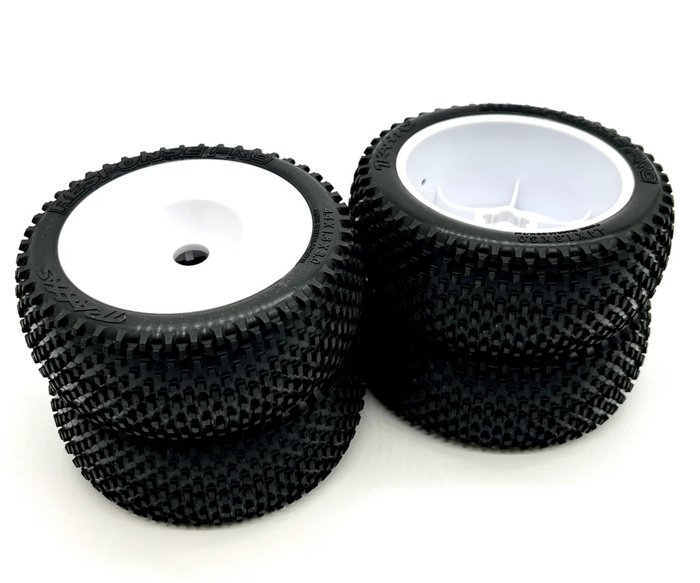 |
| 🔵 **Traxxas Sledgehammer on gray 3.0" wheels (9073)** — *street / hard-pack, good wear, in hand* | **Part:** **9073** (off Jato 4x4 BL-2s 90154-4) **Type:** 1/10 3.0" all-terrain **Tread:** Sledgehammer (aggressive all-terrain) **Compound:** N/A **Dia:** N/A **Width:** N/A **Rim:** gray 3.0" wheels, 17mm hex (Traxxas) **Hex:** 17mm **Weight:** N/A (bigger tire) **Foam:** included **Pre-glued:** assembled / glued **Price:** **$36.97 / set of 4** (Jenny's RC) | Pro: **Great for street**, and unlike the soft race tires the **wear is good, it lasts a long time**. OEM assembled with foam  Con: **Same category as the R306 grass/concrete tread**, not ideal for the blown-out dirt race track. Bigger / heavier than the buggy race tires | 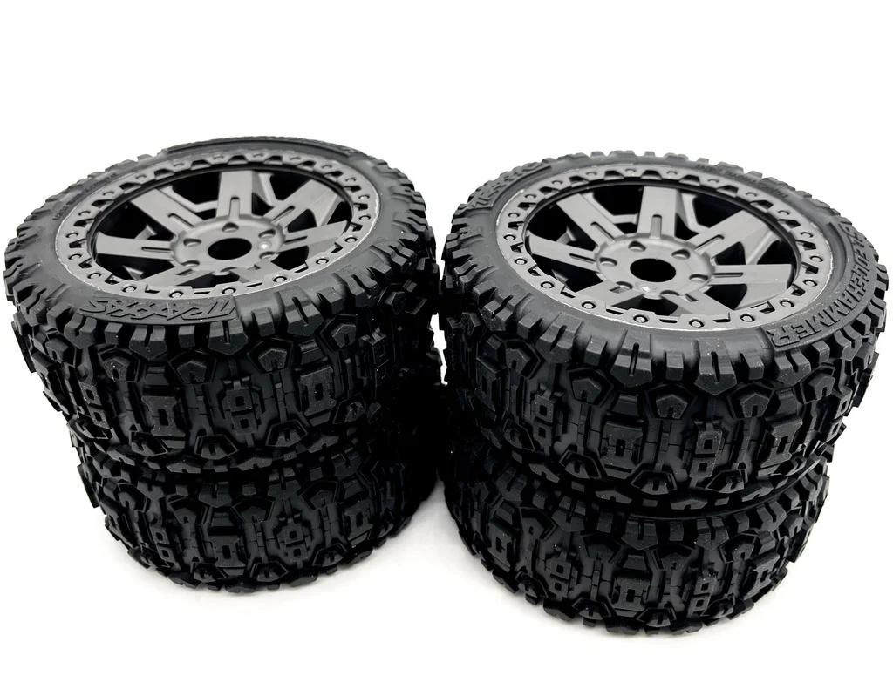 |

---

## Tires (tire only, mount on your own rims)

Bare tires, no rim. Mount on 17mm-hex rims with a [foam insert](#foam-inserts).

> *Spec format: Part · Type · Tread · Compound · Dia · Width · Rim · Hex · Weight · Foam · Pre-glued · Price*

| Tire | Spec | Pros / Cons | Photo / Link |
|---|---|---|---|
| 🟢 **Kforce 1/8 buggy tires, "Mitsubishi-logo" tread (26013)** — *in hand, superseded by the 86B-801 as the daily set* | **Part:** **26013**, listed as "1/8 buggy tire triangle" by **Fiona Hobby** on AliExpress. ⚠️ **Search the store and the number, not the brand**. The listing never says Kforce, that's only on the tires when they turn up **Type:** 1/8 off-road buggy, practice level (**tires only, no rims**) **Tread:** "Mitsubishi-logo" style clusters, hole in the middle; the seller also lists it as **triangle tread, practice compound** **Compound:** natural rubber, 35° hardness **Dia:** **110mm** (OD) **Width:** **43mm** **Rim:** none (mount on 17mm rims) **Hex:** N/A (tire only) **Weight:** ~310 g / set **Foam:** **none included** (Tire-Only variant), was run with the blue closed-cell race foams **Pre-glued:** No **Price:** **$3.87 / set of 4** | Pro: **$3.87 shipped for a set of 4**, the cheapest tires here by a mile. **Once worn in, very durable.** Grip is OK, fits standard 1/8 wheels  Con: **Softer compound, so it needs a slow wear-in.** Let it stretch gradually over the first runs before driving it hard | 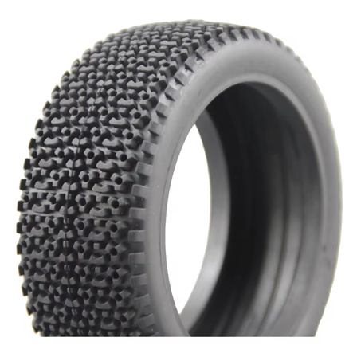 |
| 🔵 **Generic 1/8 buggy tires, T-shape tread** — *tires only, with blue race foam, in hand* | **Part:** N/A (generic AliExpress) **Type:** 1/8 off-road buggy (**tires only, no rims**) **Tread:** T-shape lugs **Compound:** soft **Dia:** N/A **Width:** N/A **Rim:** none (mount on 17mm rims) **Hex:** N/A (tire only) **Weight:** N/A **Foam:** **included, nice closed-cell race foam** (blue) **Pre-glued:** No (tires only) **Price:** **$13 / set of 4** | Pro: **Comes with good closed-cell race foam** (holds shape better than the RedSpider's packing sponge). Cheap set of 4  Con: **Tires only, no rims**, mount them yourself. Unproven on my track vs the RedSpider | 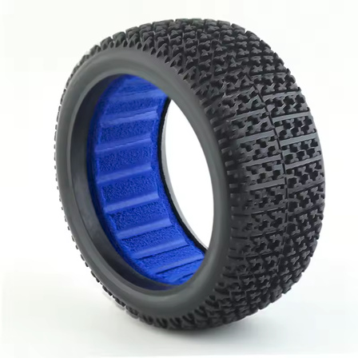 |
| 🔵 **Kforce 1/8 buggy tires, cube tread (2S014)** — *tires only, in hand* | **Part:** **2S014**, from **Fiona Hobby Trading Co Ltd** on AliExpress, **same store as the 26013 above**. ⚠️ Sold unbranded like the 26013; the **Kforce** marking only shows on the tires themselves **Type:** 1/8 off-road buggy, **practice level** (**tires only, no rims**) **Tread:** **cube**, dense small block **Compound:** **natural rubber, medium-soft** **Dia:** **112mm** (OD) **Width:** **43mm** **Rim:** none (mount on 17mm rims) **Hex:** N/A (tire only) **Weight:** **272 g / set of 4** (68 g each, measured) **Foam:** none **Pre-glued:** No **Price:** **$10 / set of 4** | Pro: **$10 for four**, second cheapest after the $3.87 Mitsubishi-tread set, and the **lightest of the bare tires** at 272 g/set, 38 g under the Mitsubishi-tread 26013 set from the same seller. Dense block tread in the same family as the mini-pin treads that suit this track. **Same Kforce practice-compound family as the 26013 I used to run**, so the durability story should carry over: soft at first, then tough once worn in. Slightly taller at **112mm against the 26013's 110mm**, same 43mm width  Con: Tires only, no rims and no foam, so budget the [foam inserts](#foam-inserts) on top. Unproven on track, no wear data yet | 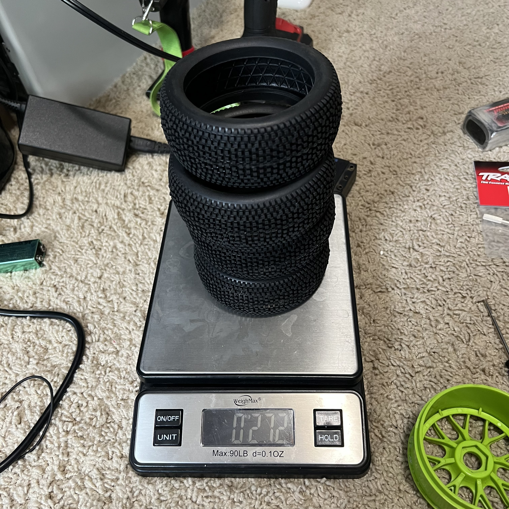 <em>272 g / set of 4</em> |

---

## Rims (bare wheels)

Bare 17mm-hex rims, for remounting a good tire or a color change.

| Rim | Spec | Pros / Cons | Photo / Link |
|---|---|---|---|
| 🟢 **IMEX 1/8th Rally chrome wheels (IMX7893)** — *in hand, superseded by the painted 86B-801 as the daily set* | **Part:** **IMX7893** (IMEX 1/8 Rally Tire Set, pair, chrome) **Type:** chrome 5-spoke swirl 1/8 buggy rim, ships mounted and pre-glued with rally / on-road tires **Size:** **103 × 41mm** (4.06 × 1.61") **Hex:** 17mm **Fits:** 1/8 buggies and most 1/10 cars (per IMEX), front + rear on this build. **A bit narrower than a standard 1/8 rim**, standard 1/8 tires still go on with some finesse **Sold as:** pair (2), mounted and pre-glued **Weight:** **210 g / pair** mounted with the rally slicks (measured), 103 g each listed **Price:** **$19.99 / pair** list at IMEX (~$39.98 for the 4 on the car) | Pro: **Straight-up baller.** The chrome swirl gives it that ricer look, and with the FLM extended arms stretching the stance it reads like an extended-swingarm GSX-R. Looks great and performs well. The rally slicks **worked really well on track and were fun to drift**  Con: **The rims are old, so the glue on the slicks had deteriorated**, and the slicks aren't a racing tire, so they came off and the Mitsubishi-tread 26013 tires were mounted instead (now also retired, see [Full Wheels](#full-wheels-mounted-tire--rim-sets)). **Rim is a bit narrower than standard**, so mounting a standard 1/8 tire (like the Mitsubishi-tread 26013) takes some finesse. $19.99 a pair, so about $40 for four, pricier than a plain dish rim and bought for the looks | 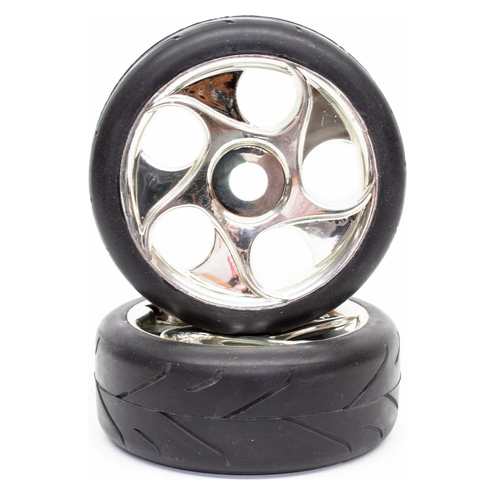 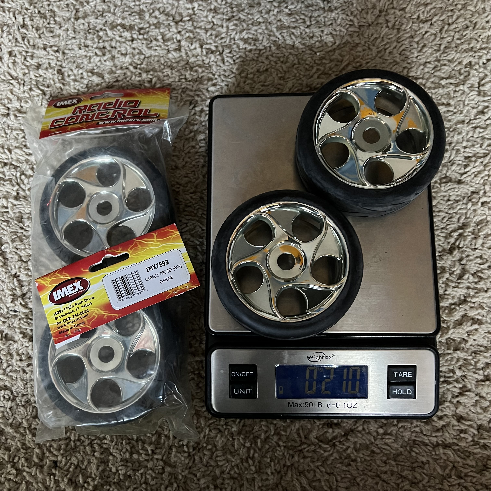 <em>210 g / pair with slicks</em> |
| 🟢 **RED SPIDER BBS-style rims** — *bare rims, in hand* | **Part:** N/A (RED SPIDER) **Type:** BBS-style multi-spoke 1/8 buggy rim **Size:** 1/8 buggy, 17mm hex **Hex:** **17mm standard** (non-star) **Fits:** front or rear, standard width **Sold as:** set of 4, normally ships mounted with tires and foams **Weight:** **166 g / set of 4** (41.5 g each, measured) **Price:** N/A (left over from a mounted set) | Pro: **In hand and free**, left over after the tires on that set blew out, so the rims outlived the rubber. Standard 17mm non-star hex, so unlike the Traxxas 9070 it drives off **both** the front TKR1654-17 and the rear TKR5570-17 with no filing  Con: Bare rims only, needs tires and foams. Heavier than a dished race rim would be, the BBS spoke pattern is the look tax | 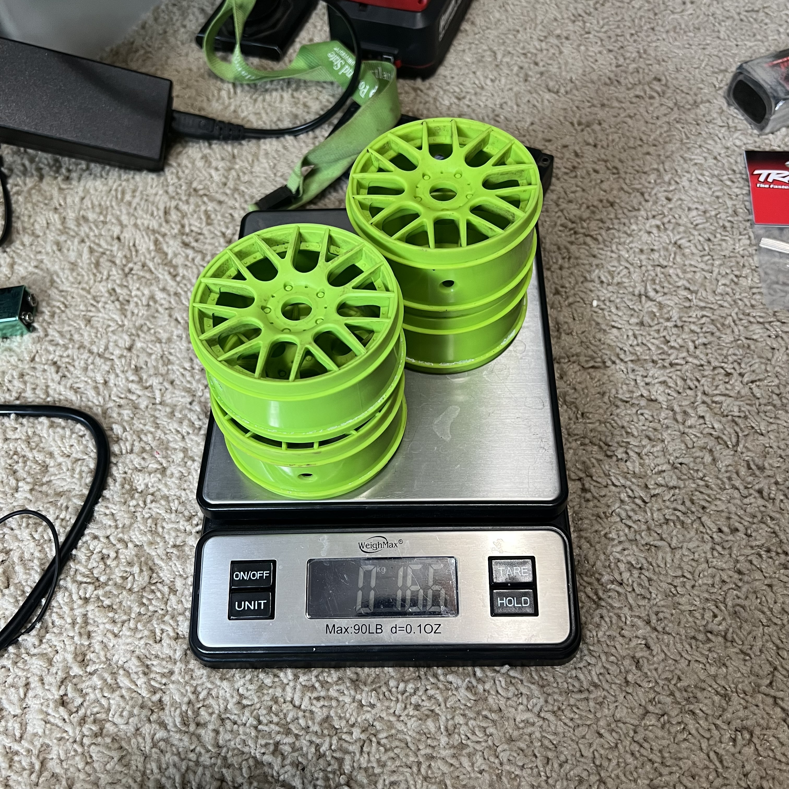 <em>166 g / set of 4</em> |
| 🔵 **Traxxas 3.0" White Dished Wheels (9070-WHT)** — *bare rim, splined/star hex* | **Part:** 9070-WHT **Type:** 3.0" dished wheel (bare rim) **Size:** 3.0" **Hex:** **17mm splined (star)** **Fits:** front or rear; needs 17mm hubs + nuts; bare version of the Response Pro white wheel **Sold as:** pair (2) **Price:** **$8.00 / pair** | Pro: Cheap OEM 3.0" dished rim, splined hex locks on solid. Handy for remounting a tire in white  Con: **Splined / star hex only**, the front non-star hex (TKR1654-17) won't drive it without cutting the teeth. Same wide Traxxas wheel, so it widens the track (fine in mod class, see [notes](#notes)) | 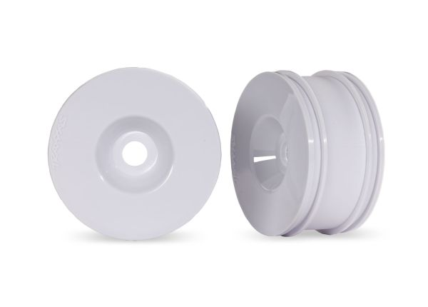 |

---

## Foam Inserts

The insert matters as much as the tire. **Closed-cell blue foams, sold on their own (4-pack, $8.08), are the best insert I run**, worth buying separate rather than relying on whatever sponge a cheap tire ships with.

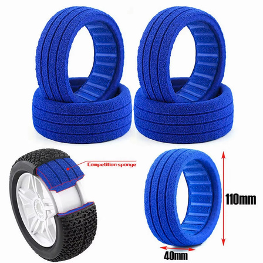&nbsp;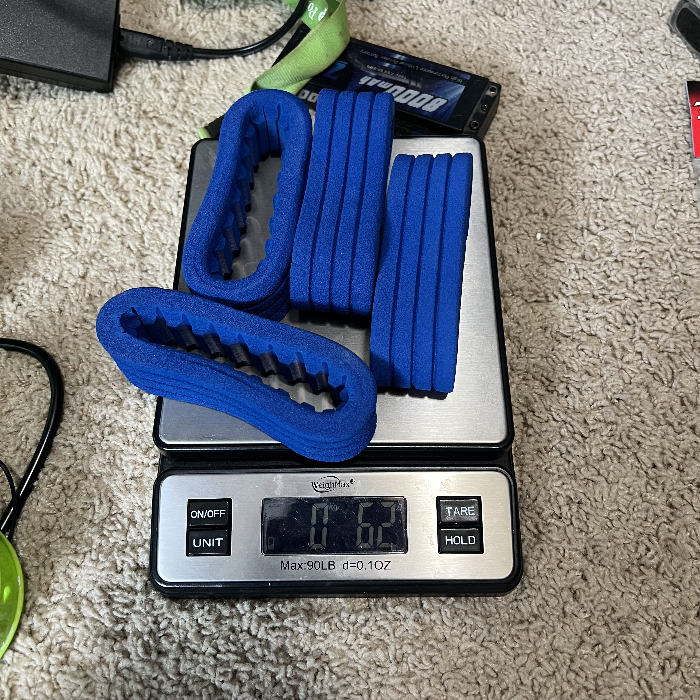 <em>Standalone closed-cell foam inserts (4pcs, $8.08, HPI-compatible 1/8) · 20 g / set of 4</em>

- **Reusable many times**, they don't pack out like the soft packing sponges (e.g. the RedSpider's).
- **Keeps the car planted** and cuts **rim slap** (tire collapsing onto the rim over bumps), so better overall control.
- **Adds a bit of weight**, which actually **helps air control** / stability when the car's off a jump.
- Generic 4Pcs 1/8 foam inserts (HPI-compatible), **$8.08 / set of 4**, **20 g / set** (5 g each, measured).

---

## Price History

| Date | Price | Discount Path | Notes |
|---|---|---|---|
| 2026-10-01 | **$26.79** ✅ **purchased** | List $32.29, built-in instant discount | Shop1105264859 Store, AliExpress. Black 86B-801 set, painted chrome at home. 🚧 Order ID not visible in the saved screenshot. See [Full Wheels](#full-wheels-mounted-tire--rim-sets) |

---

## Notes

- **86B-801 weigh-in needs a recheck.** Measured: set of 4, mounted + foamed = **430.7 g** (on a separate pocket scale); bare rim pair = **🚧 144 g** (72 g each); bare tire stack (×4, no rim) = **🚧 ~241 g** (~60 g each, two readings: 240 g and 242 g); foam stack (×4) = **🚧 ~0.14** on the postal scale, unit unclear. Rim + tire alone (72 + 60 = 132 g/wheel) already exceeds the assembled-set average (107.7 g/wheel), which isn't physically possible, so one of these readings is off, most likely the first pocket scale wasn't zeroed/tared before the stack-of-4 shot. Treat all four numbers as 🚧 pending a re-weigh before trusting them for a build weight budget.

  

    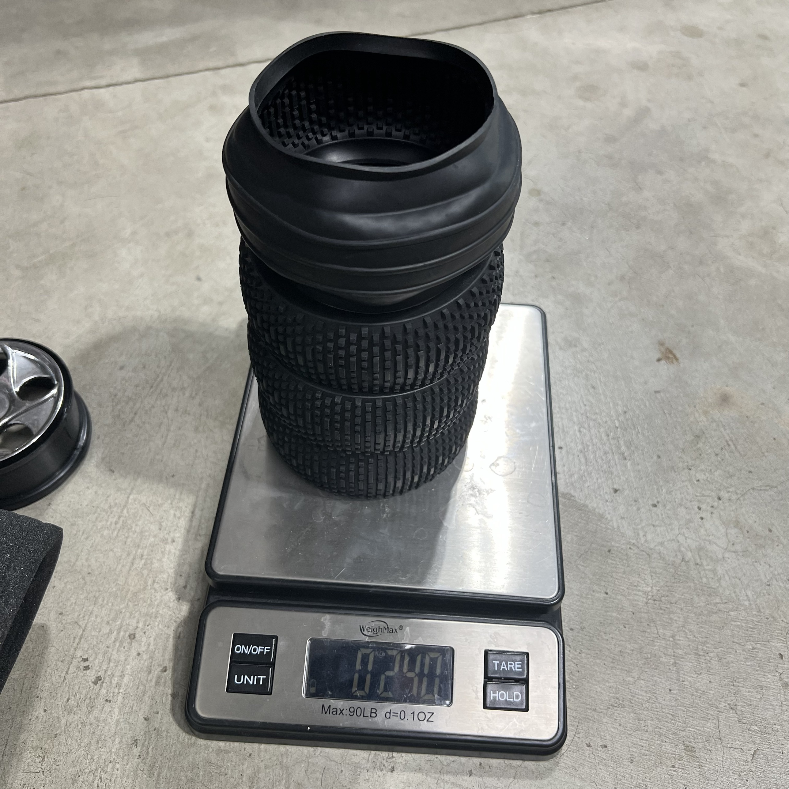&nbsp;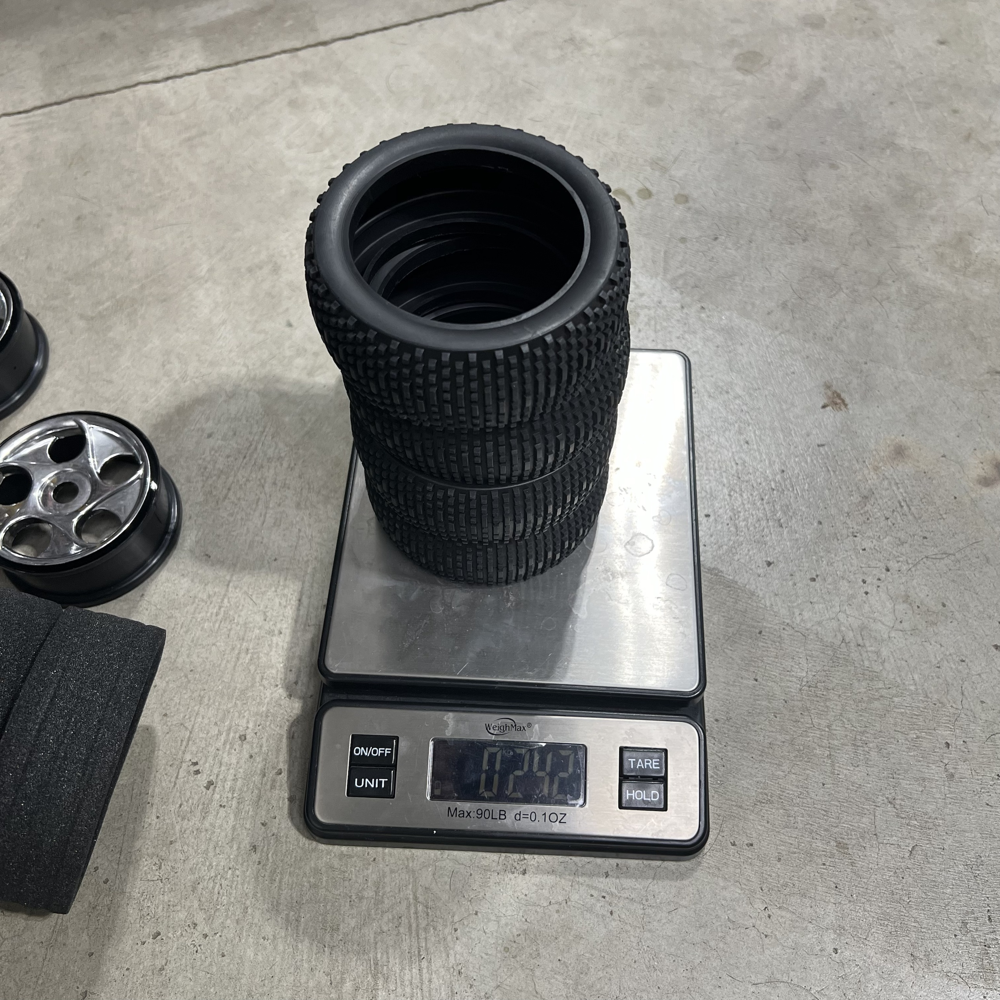&nbsp;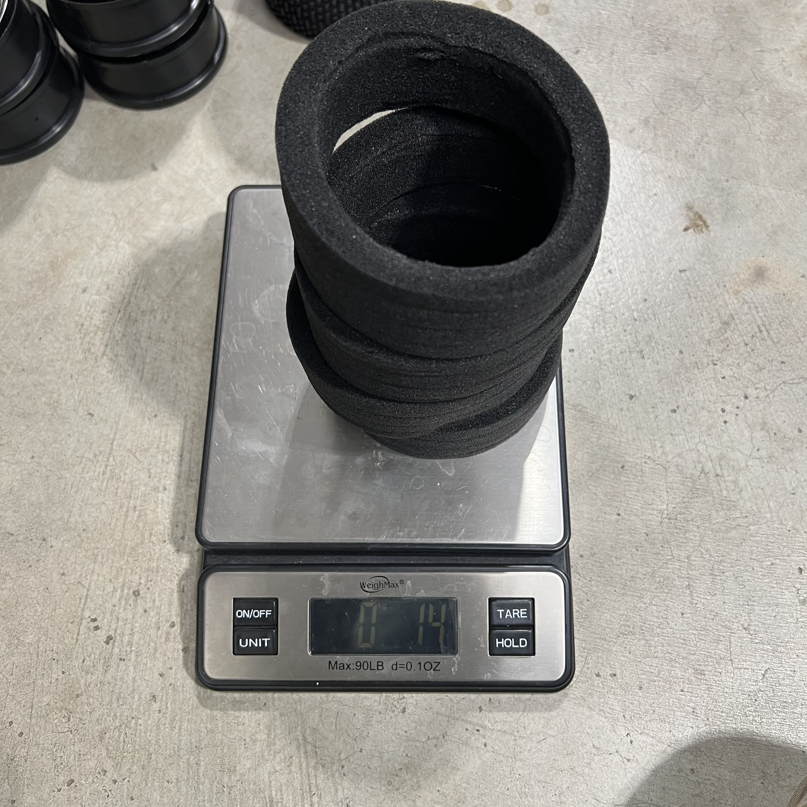 
    <em>🚧 bare tire stack, two readings (240 g · 242 g) · 🚧 foam stack, 0.14 (unit unclear)</em>
  

- **Chrome finish is a paint marker, not real chrome plating**, on the 86B-801 set. Bought the black version and colored the rim faces by hand for the IMEX look at a fraction of the price. Looks right so far; how the paint holds up under grit and tire scrub isn't proven yet.
- **Blue foam swap probably wasn't necessary on this set.** Carried the blue closed-cell foams over from the old IMEX/26013 combo, but given how stiff the 86B-801 tire already is, the stock foam that shipped with it would likely have worked fine. Noted for next time: don't auto-upgrade the foam on a tire that's already firm. It also wears out at about the same rate as the stock foam would have, so the swap bought nothing here.
- **Drainage holes: punched 180° apart with a $7.99 Harbor Freight leather hole punch**, so water and dirt that get inside the rim have somewhere to drain instead of pooling. Works on any rim, not just this one; keep the tool in the kit for future wheel builds.

  
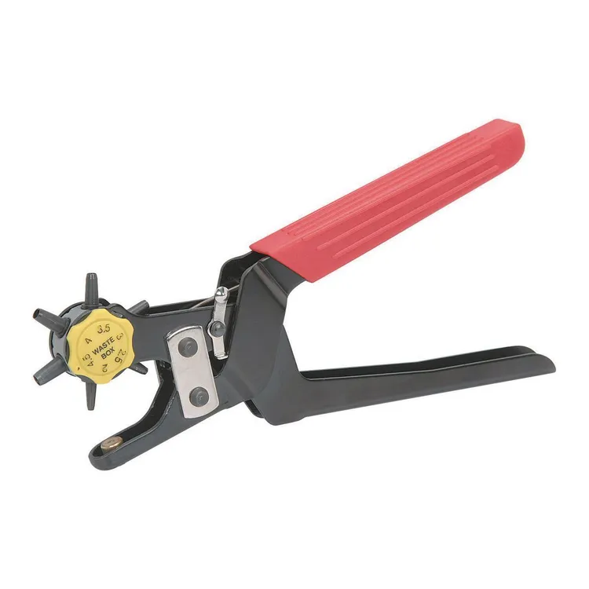 <em>Harbor Freight leather hole punch, $7.99, used to punch drain holes 180° apart in the rim</em>

- **The Kforce tires are sold unbranded, so shop by store and part number.** Both the 26013 and the [2S014](#tires-tire-only-mount-on-your-own-rims) come from **Fiona Hobby** on AliExpress and neither listing mentions Kforce anywhere; **you only find out what they are when you open the package**. Searching "Kforce" gets you nothing; searching the store plus the number gets you the tire. Worth knowing before assuming a brand name is missing from the catalogue, and worth recording the **store** in any AliExpress tire row for exactly this reason.

- **Wear-in is real, don't judge them fresh.** A few laps in they come up to full grip. Mike logged roughly **7 packs to fully wear in** his RedSpider set on the [Jato](../Jato4EP/README.md#wheels--tires); same behavior here.
- **Colors are cosmetic.** The set I mounted is the same tire on different-colored rims, no performance difference.
- **Wide-track rims are an option now, it's mod class.** [Mike's Jato](../Jato4EP/README.md#wheels--tires) mounts the RedSpider tires on the **Traxxas Jato 4x4 rims**, which push the wheels out and **widen the stance by a lot**. That's over ROAR width limits, but this car runs **mod class**, so there's no width rule to respect. It still runs **standard-width rims** by choice, and the wide Traxxas rims are a solid option whenever I want the extra stability.
- **Wide rims stress the drivetrain, and that's where the Tekno stubs earn their keep.** The extra leverage from the Jato 4x4 wide rims is taxing on the suspension and axle parts and can **snap the stock OEM stubs**. This build runs **Tekno M6 stubs** (front TKR1654-17, rear TKR5570-17), strong enough that the wide-rim leverage **is no longer an issue here**. So with no ROAR rule in mod class and the stubs handling the leverage, nothing is holding the wide rims back. See [`driveshaft_analysis.md`](driveshaft_analysis.md#tekno-stubs-front--rear).
- **Related RedSpider data:** the [E-Revo tire analysis](../ERevo_1.0/tire_analysis.md) has measured dims, foam, and pricing for the 1/8 truggy RedSpider set (different size/class, but same brand and character: strong forward grip, soft compound).
- **Belted vs non-belted, the rip factor.** The soft **race** tires here (RedSpider, Tokyo Speed, unbranded, T-tread, plus the premium AKA / Pro-Line / JConcepts sets I've run) are **non-belted**, so **high RPM / an aggressive trigger rips them**, worst when unloaded (hard launches, wheelies, airborne blips). Ease into the throttle. The **belted all-terrain** tires (PowerHobby Armor, Traxxas Sledgehammer) have an internal belt that **stops ballooning and resists ripping**, so they shrug off the RPM that tears the race tires, at the cost of a bit more weight. Among the non-belted race tires the RedSpider tolerate it best. The **Mitsubishi-tread 26013** is softer, but worn in and stretched slowly it turns very durable.
- **RedSpider tread variants, match to surface.** The **R235 / R305 mini-pin** is the dirt tread (what I ran before the Mitsubishi-tread 26013). The **R306** is a bigger-knob tread that's **better on grass and some concrete**, not the pick for a blown-out dirt track. Same 118mm / 17mm-hex size across them.
- **Tokyo Speed = the mid backup.** A full set of 4 (~$20) that interchanges on the 17mm hexes. Better than stock, but middling grip and less durable than the RedSpider, and it can rip. Keep it as the alternate / spare set.
- **Still to log:** width and weight for the RedSpider set (parts **R235 / R305** (R305 = white), 118mm OD, **$18.61/set**).
